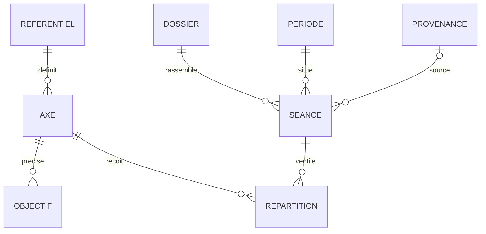
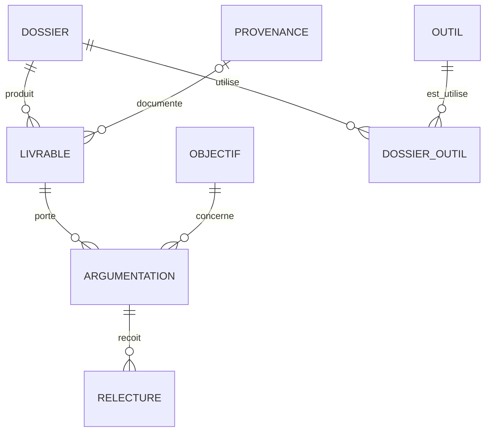

# Modèle du carnet SD

## Le suivi du temps

Chaque séance appartient à un dossier et à un semestre. Un dossier peut donc couvrir plusieurs semestres. L’année de BUT se déduit du semestre : S1/S2 → BUT1, S3/S4 → BUT2, S5/S6 → BUT3. Les dates exactes restent inconnues tant qu’elles ne sont pas renseignées.

Une séance connaît l’une des trois situations suivantes :

| Qualité | Durée | Provenance |
| --- | --- | --- |
| `inconnue` | Obligatoirement `NULL` | Facultative |
| `estimee` | Strictement positive | Facultative |
| `sourcee` | Strictement positive | Obligatoire |

« Sourcée » signifie qu’une provenance est indiquée, pas que l’université certifie le volume. Un document non publié peut justifier une durée sans exposer son contenu au visiteur.

La répartition utilise la formule :

`minutes pour un axe = durée de la séance × poids de cet axe / somme des poids de la séance`

Les poids sont des entiers entre 1 et 100. Ils n’ont pas besoin de totaliser 100. Le calcul reste en décimal ; l’arrondi des heures intervient après la somme. Pour les nombres non divisibles, la conservation est vérifiée avec une tolérance de `0.00000001` minute.

## Les livrables et leur interprétation

Une argumentation relie exactement un livrable et un objectif. Une contrainte interdit de doubler ce couple. Pour associer le livrable à un autre objectif, on ajoute une argumentation propre à cet objectif. Les avis datés portent sur l’explication, pas sur une prétendue validation automatique de compétence.

Le dernier avis **visible pour le lecteur** est retenu. Une relecture privée ne remplace donc pas l’avis présenté publiquement avant sa propre publication. L’historique reste disponible au propriétaire de la base.

## Les agrégats

| Vue | Granularité et règle |
| --- | --- |
| `v_ventilation` | Une ligne par couple séance/axe ; coefficient et minutes pondérées |
| `v_heures_par_axe` | Une ligne par dossier/axe ; temps sourcé, estimé et nombre d’inconnues |
| `v_bilan_dossier` | Une ligne par dossier ; temps, livrables, objectifs illustrés et outils |
| `v_couverture_objectifs` | Une ligne par objectif ; argumentations et derniers avis visibles |
| `public.atelier_sd_snapshot` | Une charge JSON de lecture pour cette version uniquement |

Le bilan calcule séparément les séances, les livrables, les objectifs et les outils, puis assemble leurs résultats. Ajouter deux outils ou plusieurs preuves ne multiplie pas le temps de travail.

Une somme absente reste `NULL`. Un compteur d’éléments connus peut valoir zéro : zéro livrable visible est une information différente de zéro heure supposée.

## Publication et administration

Le propriétaire administre les données par SQL ou Supabase Studio. Les visiteurs `anon` et `authenticated` ont uniquement un accès en lecture aux contenus publiés ; une connexion ne donne aucun droit de rédaction.

Un dossier doit être `public`. Chaque séance, livrable, argumentation et relecture doit aussi être explicitement publié et avoir son parent visible. Les associations de temps et d’outils suivent la visibilité de leur parent. Les références pédagogiques et les outils sont lisibles.

Les 13 tables ont RLS activé. Les vues utilisent `security_invoker`, donc les mêmes règles de lecture s’appliquent aux agrégats. Aucun code `SECURITY DEFINER` n’est introduit.
